# Semantic UI audit and implementation report

Date: 18 October 2026. Scope: entire application source inventory, targeted semantic redesigns. This is a local implementation, not a production deployment.

## What changed and why

| Page / workflow | Before | Implemented interaction | Why it fits the task |
|---|---|---|---|
| Learning path | Repeated standalone topic cards | Compact aligned topic rows; native mastery meters only for measured estimates; search and availability filters retained; daily agenda and future disclosure retained | Learners compare mastery, evidence and whether they can start before selecting a topic. Unknown is distinct from zero. |
| Mistake notebook | Full questions, choices, solutions and notes exposed in repeated bordered boxes | Collapsible question index; expand one question to inspect answers and edit notes; nested optional solution; blank selection uses neutral language | Learners first locate the question worth revisiting, then work through its mathematics without scrolling through every solution. |
| Learning tasks / missions | Fixed zero progress, invented XP and one-day streak | Ordered actionable checklist, actual completed-diagnostic flag, direct routes to learning and notebook | Helps choose a next action without implying earned rewards or measured daily progress. |
| Review | Equal statistic blocks and explanatory copy precede action | Start review immediately after heading; supporting counts in a compact strip; recall-method explanation disclosed; recommendation entries separated by rules | Starting recall practice is the primary job. Explanation remains available without delaying it. |
| Competency profile | Radar/chart plus duplicate skill-card list; lower list could turn missing estimates into zero | Retain the existing radar, filtered comparison bars and evidence rules; remove redundant lower list | A single skill comparison avoids conflicting labels, duplicate reading and false weakness for unknown skills. |
| Student result dialog | Blank/noncorrect outcomes conflated; every solution expanded | Explicit textual/symbol states and matching navigator; collapsed methods; question jump and review filter retained; focus includes disclosure summaries | Students inspect their actual answer state and open the method when needed. Pending/credited/excluded questions are excluded from the remediation filter. |
| Teacher response inspection | Incorrect and blank merged as “Sai / Bỏ trống” | Shared presentation classifier distinguishes answer absence, completeness, grading and adjustment | Teachers can tell lack of response from an attempted error before choosing intervention. |
| Shared tutor | Floating launcher overlaps controls | Launcher occupies a normal-flow toolbar; chat opens a separate panel only on request | Search, mathematical options and actions stay unobstructed. |

## Before / after evidence

Before images below are archived from the existing site audit, **not newly captured matched-data baselines**. After images use controlled student API fixtures and the actual local UI. Data, dates and prior styling may differ; use these pairs to inspect interaction structure, not to infer measured performance gains. No XP, score gains or learning effectiveness is claimed.

### Learning path

Before (archived desktop):

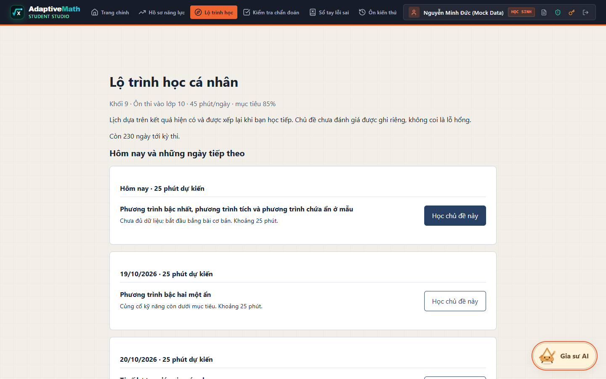

After (desktop):

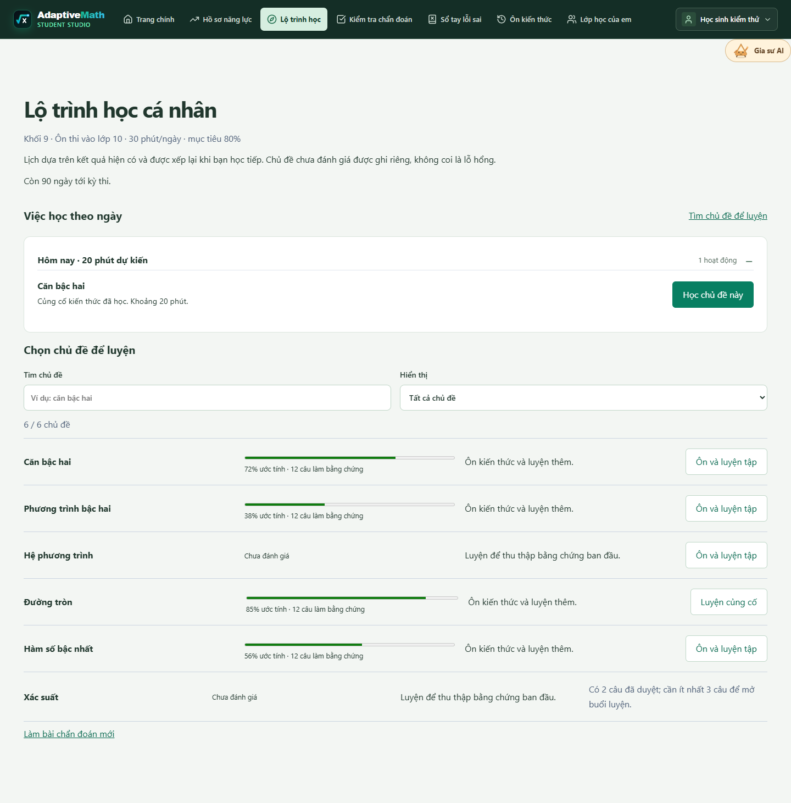

After (390px):

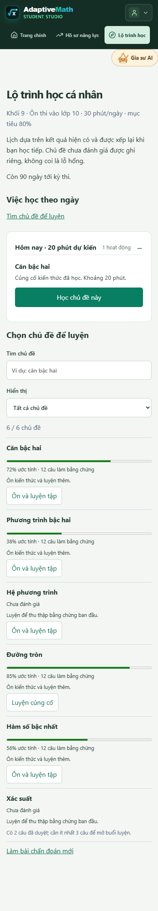

### Mistake notebook

Before (archived desktop):

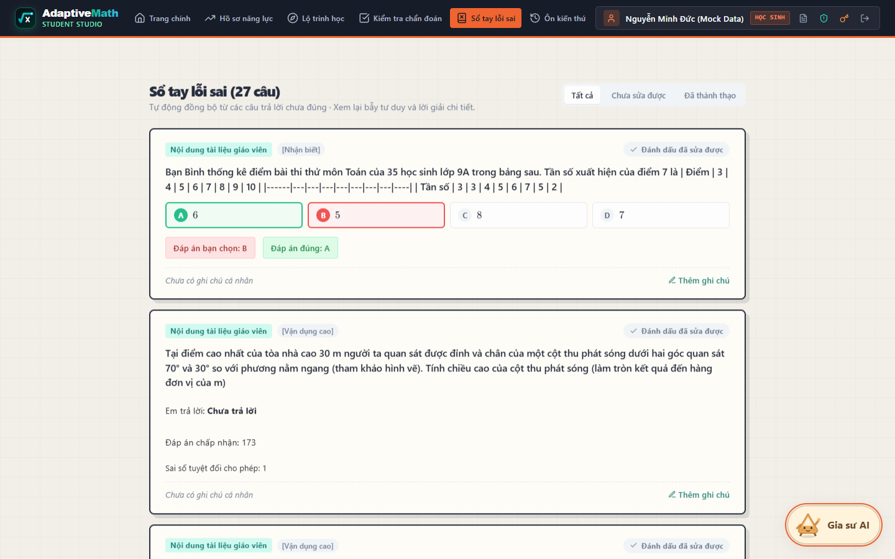

After (desktop index):

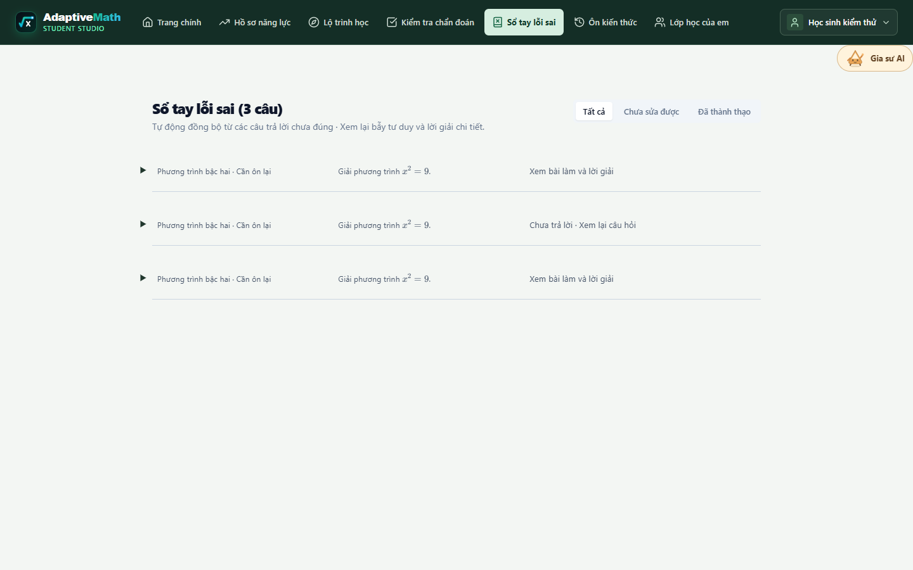

After (expanded answer and solution):

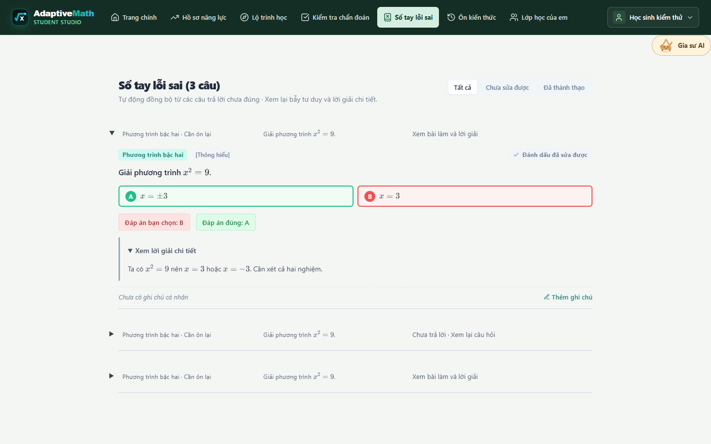

### Review

Before (archived mobile):

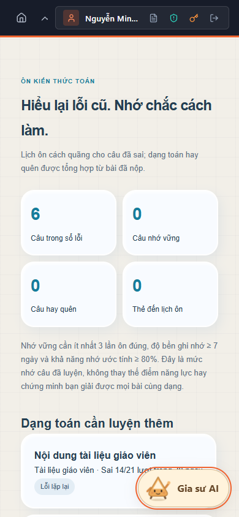

After (mobile, primary action before statistics):

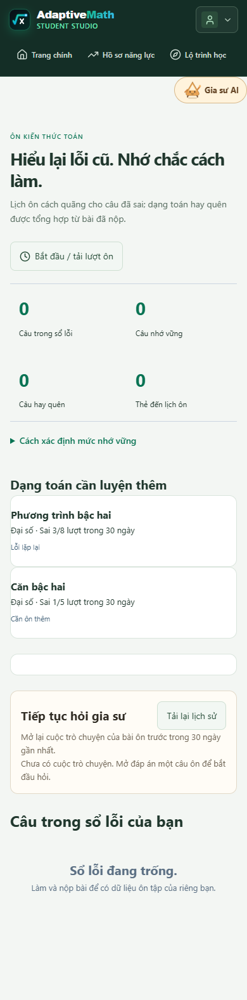

### Competency profile

Before (archived desktop):

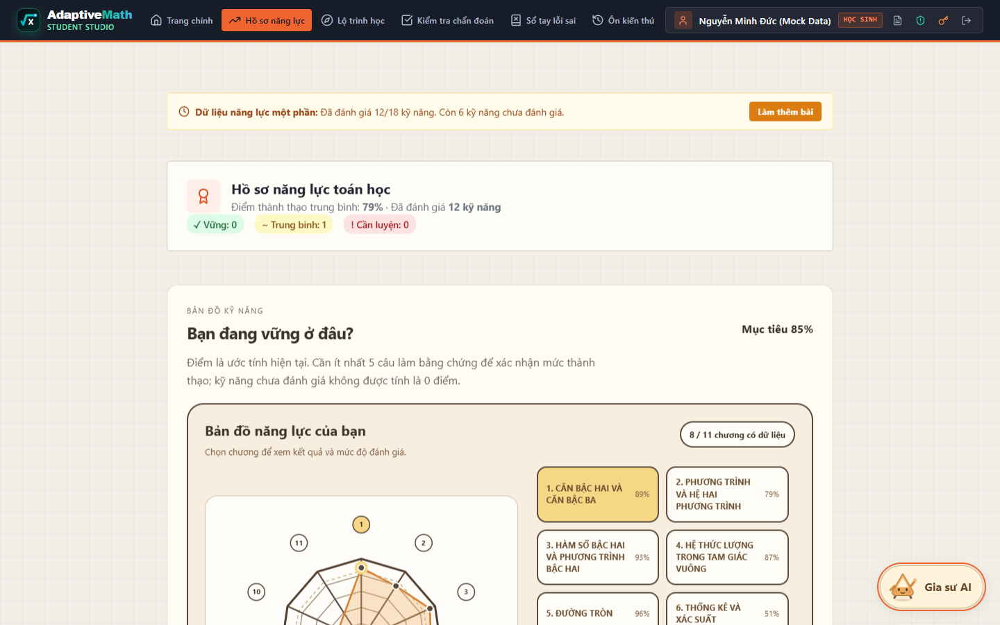

After (single comparison source):

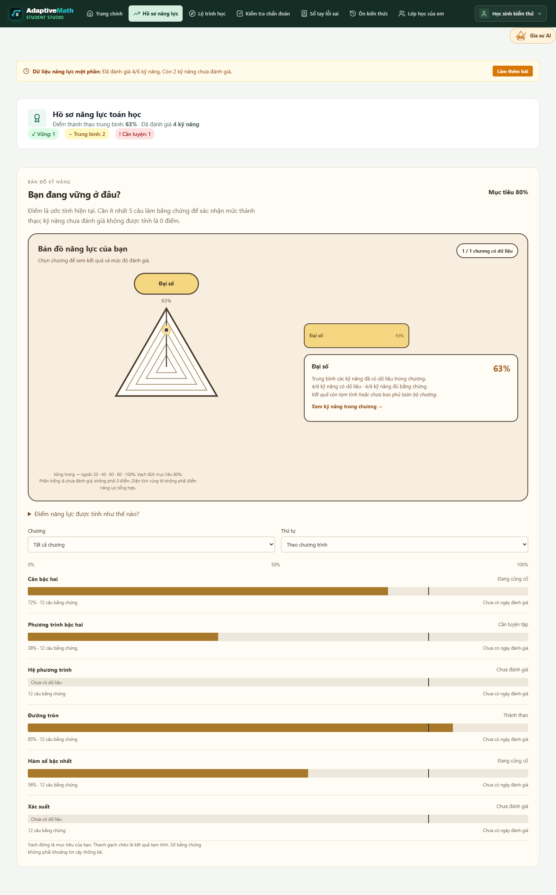

### Task checklist and assessment results

No matched before capture exists for these states. Source findings above describe the previous behavior.

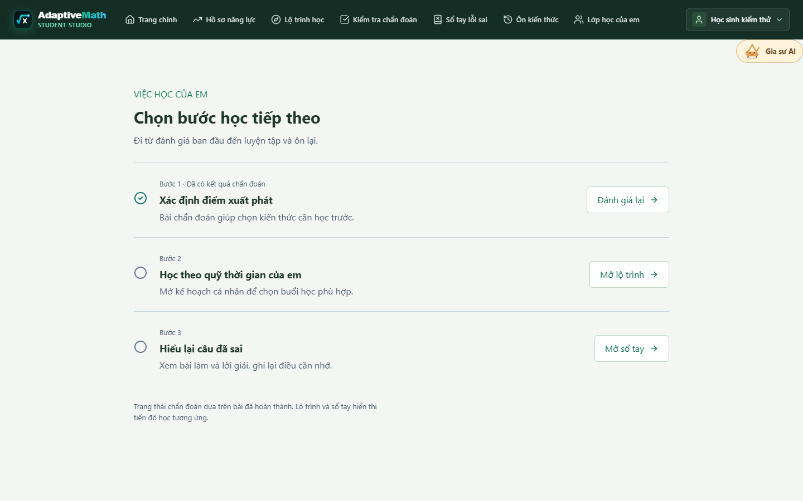

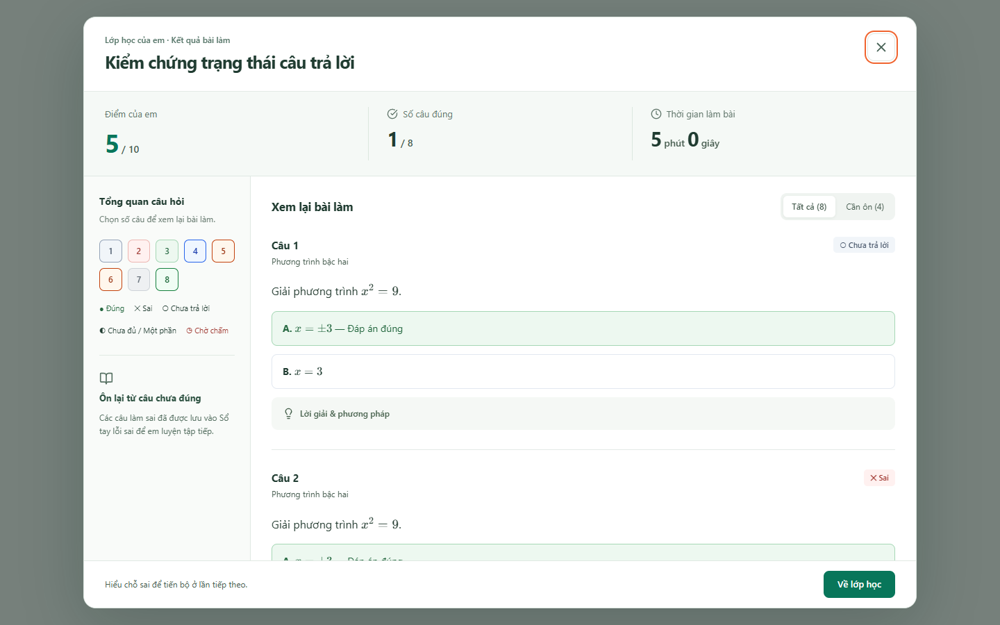

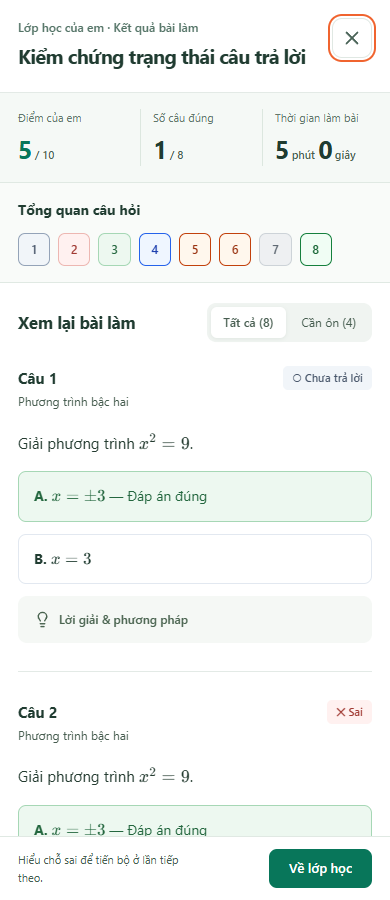

## Whole-application audit coverage

The [design contract](ui-semantic-design-contract.md) inventories learner, teacher, admin, entry and shared surfaces, including appropriate patterns and states per page. Existing report tables, score distributions, question-bank exploration, class rosters, focused exam editing and assessment workspaces were retained where they already support comparison, exploration or answering. This task does not indiscriminately restyle those workflows. Remaining improvements and the independent decision are in the [finish gate](ui-semantic-finish-gate.md).

## Validation and limits

- Production bundle compiles in `tmp/semantic-build-final`. The default `dist/assets` directory was locked, so build validation used a separate output folder.
- 15 targeted Node tests pass, covering answer-state classification, assessment display/activity, navigation and report insights.
- Ten page/viewport captures: five changed learner pages at 1440 and 390 pixels; no runtime errors or document horizontal overflow in the controlled fixture. Search/no-results/reset and question/solution disclosure behavior pass.
- Result dialog: eight states asserted, repeated Tab remains inside, Shift-Tab wraps, Enter toggles solution. Accessibility scan of this result fixture reports zero WCAG A/AA violations. This is not a whole-app accessibility certification.
- Mathematical rendering uses the existing KaTeX renderer. Backend scoring, adaptive assessment calculations and publication policies were not changed. The answer classifier is presentation-only.
- Teacher answer-drawer labels share the tested classifier, but this task has no new end-to-end teacher-drawer capture. Unchanged admin/teacher/entry flows were source-audited, not all rerun against a live server.
- Controlled fixture evidence is reproducible through `scripts/audit-semantic-ui.mjs` and `scripts/verify-semantic-results.mjs` with the app on port 3011. It does not establish live database connectivity, production behavior or educational efficacy.
