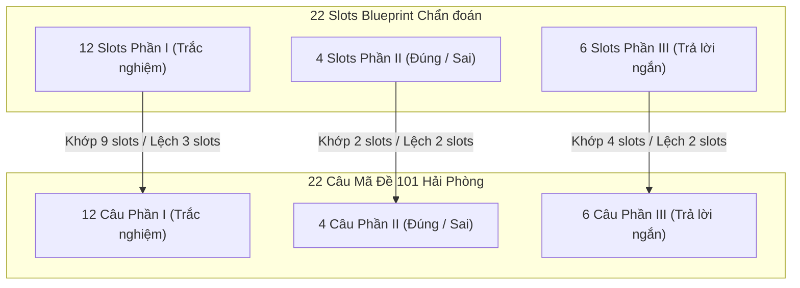

# BÁO CÁO KIỂM TOÁN VÀ THẨM ĐỊNH NHÃN KIẾN THỨC, MỨC ĐỘ NHẬN THỨC MÃ ĐỀ 101

> **Dự án:** Adaptive Math — Hệ thống học tập thích ứng môn Toán  
> **Tài liệu nguồn:** `02_De_tong_hop/02_Khao_sat_Hai_Phong_2025_2026.pdf` (Mã nguồn: `SRC009`, Mã đề 101)  
> **Thư mục dữ liệu:** `04_Trich_xuat_Gemini/full-exam-101-labeled/`  
> **Ngày lập báo cáo:** 17/10/2026  
> **Trạng thái thẩm định:** `labelReviewStatus: "NEEDS_REVIEW"` (100% câu hỏi đang chờ chuyên gia phê duyệt)

---

## 1. Mục tiêu và Căn cứ Pháp lý & Chuyên môn

### 1.1. Phạm vi chương trình GDPT 2018
- Toàn bộ việc gán nhãn kiến thức, năng lực và yêu cầu cần đạt được xây dựng dựa trên **Chương trình Giáo dục phổ thông 2018 môn Toán** (ban hành kèm theo Thông tư số 32/2018/TT-BGDĐT ngày 26/12/2018 của Bộ Giáo dục và Đào tạo).
- Môn Toán lớp 9 theo chương trình GDPT 2018 chính thức được triển khai toàn quốc từ **năm học 2024–2025**.
- Đề thi khảo sát chất lượng của Sở GD&ĐT Hải Phòng năm học **2025–2026** (Mã đề 101) phản ánh chính xác cấu trúc đề thi khảo sát và định dạng tuyển sinh vào lớp 10 theo chương trình GDPT 2018 với 3 phần rõ rệt:
  - **Phần I:** Trắc nghiệm nhiều lựa chọn (12 câu, 3,0 điểm).
  - **Phần II:** Trắc nghiệm Đúng / Sai (4 câu chính, mỗi câu 4 ý độc lập, tổng 4,0 điểm).
  - **Phần III:** Trắc nghiệm trả lời ngắn (6 câu độc lập, 3,0 điểm).

### 1.2. Phân định rõ ràng với tài liệu tham khảo Củ Chi (2023–2024)
- **Tài liệu tham khảo Củ Chi:** Bộ đề tham khảo Cuối học kỳ 1 Toán 9 năm học 2023–2024 (Phòng GD&ĐT Củ Chi, TP.HCM).
- **Phạm vi & Sự khác biệt:**
  - Năm học 2023–2024, khối lớp 9 vẫn đang học theo **Chương trình GDPT 2006** (chưa áp dụng GDPT 2018 ở lớp 9).
  - Đề thi Củ Chi 2023–2024 có cấu trúc tự luận truyền thống kết hợp trắc nghiệm cũ, phạm vi thuần túy là Học kỳ I, chưa xuất hiện dạng trắc nghiệm Đúng/Sai 4 ý phân hóa điểm số hoặc câu hỏi trả lời ngắn theo định dạng mới.
  - Do đó, tài liệu Củ Chi chỉ được sử dụng làm tham khảo đối sánh về dạng bài toán thực tế cục bộ; tuyệt đối không dùng để suy diễn ma trận hay chuẩn kiến thức cho chương trình GDPT 2018 của Đề Hải Phòng 2025–2026.

### 1.3. Nguồn gốc mức độ nhận thức trong tài liệu Hải Phòng
- Tài liệu PDF gốc `02_Khao_sat_Hai_Phong_2025_2026.pdf` chỉ bao gồm đề bài và bảng đáp án chữ cái/số cuối tài liệu (Trang 9), **không đính kèm bản đặc tả hay ma trận đề thi chính thức**.
- Vì vậy, theo nguyên tắc minh bạch dữ liệu:
  - Tất cả mức độ nhận thức gán cho từng câu hỏi đều mang cờ `classificationOrigin: "MODEL_PROPOSED"`.
  - Trường `sourceLevel` được ghi rõ là `null`.
  - Mọi câu hỏi đều giữ trạng thái `labelReviewStatus: "NEEDS_REVIEW"` để giáo viên chuyên môn thẩm định trước khi đưa vào ứng dụng.

---

## 2. Danh mục Nhãn Thống nhất (Unified Taxonomy Framework)

Hệ thống nhãn được chuẩn hóa tại `taxonomy.json` bao gồm 3 mạch kiến thức lớn, 10 chương chuyên đề, và danh mục kỹ năng kết hợp giữa cơ sở dữ liệu dự án hiện có và ma trận Blueprint chẩn đoán.

### 2.1. Ba Mạch Kiến thức Cốt lõi
1. `ALGEBRA`: **Đại số và một số yếu tố giải tích**
2. `GEOMETRY`: **Hình học và đo lường**
3. `STATISTICS_PROBABILITY`: **Thống kê và xác suất**

### 2.2. Danh mục Kỹ năng Chuẩn (18 Skills)
Gồm 8 kỹ năng pilot đã có trong `prisma/seed.ts` và 10 kỹ năng chuyên đề trong `docs/diagnostic-grade9-blueprint.md`:
- `SKILL-01`: Căn bậc hai và căn thức cơ bản
- `SKILL-02`: Biến đổi và tính toán với căn thức
- `SKILL-03`: Phương trình bậc nhất 2 ẩn và Giải hệ phương trình
- `SKILL-04`: Giải bài toán bằng cách lập hệ phương trình
- `SKILL-05`: Phương trình bậc hai một ẩn
- `SKILL-06`: Định lý Viète và ứng dụng
- `SKILL-07`: Tỉ số lượng giác của góc nhọn
- `SKILL-08`: Đường tròn và góc nội tiếp
- `MATH9-LINEAR-EQUATIONS`: Phương trình quy về bậc nhất
- `MATH9-LINEAR-INEQUALITY`: Bất đẳng thức và bất phương trình bậc nhất một ẩn
- `MATH9-CUBE-ROOTS`: Căn bậc ba và ứng dụng
- `MATH9-QUADRATIC-FUNCTIONS`: Hàm số $y = ax^2$ và đồ thị
- `MATH9-CYCLIC-POLYGONS`: Góc nội tiếp, tứ giác nội tiếp và đa giác đều
- `MATH9-STATISTICS`: Một số yếu tố thống kê
- `MATH9-SOLIDS`: Hình khối trong thực tiễn (hình trụ, hình nón, hình cầu)
- `MATH9-PROBABILITY`: Một số yếu tố xác suất
- `MATH9-ALGEBRA-OPTIMIZATION`: Bất đẳng thức nâng cao và cực trị đại số
- `MATH9-REVIEW-REQUIRED`: Nhãn tạm cho câu hỏi cần xem xét chuyên sâu

### 2.3. Đề xuất Bổ sung Kỹ năng Chuyên biệt (`taxonomy-proposals.json`)
Trong quá trình gán nhãn chi tiết cho 22 câu Mã đề 101, hệ thống phát hiện 4 chuyên đề có tính đặc thù cao, nếu ép vào các mã kỹ năng cha rộng sẽ làm mất độ mịn khi chẩn đoán năng lực học sinh. Bốn đề xuất này được lưu độc lập tại `taxonomy-proposals.json` (chưa can thiệp database):

1. **`MATH9-CIRCLE-RELATIONS`**: *Vị trí tương đối của hai đường tròn* (Ánh xạ câu `SRC009-P001-Q002`).
   - *Lý do:* Phân biệt năng lực nhận biết hệ thức nối tâm $d$ và bán kính $|R_1 - R_2| < d < R_1 + R_2$ với các bài toán góc nội tiếp thuần túy của `SKILL-08`.
2. **`MATH9-CIRCULAR-SECTOR`**: *Độ dài cung tròn, diện tích hình quạt tròn và hình vành khuyên* (Ánh xạ câu `SRC009-P001-Q006`).
   - *Lý do:* Bài toán tính diện tích quạt tròn $S = \frac{\pi R^2 n}{360}$ mang tính đo lường công thức, không yêu cầu tư duy hình học suy diễn của `SKILL-08`.
3. **`MATH9-PARABOLA-INTERSECTION`**: *Sự tương giao giữa parabol $y = ax^2$ và đường thẳng* (Ánh xạ câu `SRC009-P003-Q004`).
   - *Lý do:* Đây là chuyên đề trọng tâm ôn thi vào 10, liên kết phương trình hoành độ giao điểm, định lý Viète và tính chất toạ độ giao điểm.
4. **`MATH9-ALGEBRA-REDUCTION`**: *Kỹ thuật hạ bậc đa thức và rút gọn căn thức liên hệ nghiệm phương trình* (Ánh xạ câu `SRC009-P003-III-Q002`).
   - *Lý do:* Dạng toán phân hóa vận dụng cao, kết hợp nghiệm $x^2 = ax + b$ để hạ bậc $x_1^4 \to 56x_1 - 15$ và đưa về hằng đẳng thức căn $(7 + 3\sqrt{3})^2$.

---

## 3. Nguyên tắc Phân định Mức Nhận thức theo Bản chất Toán học

Chúng tôi tuân thủ nghiêm ngặt nguyên tắc **đánh giá theo nội dung và thao tác tư duy toán học**, tuyệt đối không suy diễn theo hình thức câu hỏi:
- **KHÔNG SUY DIỄN:** Nhiều lựa chọn = Nhận biết; Đúng/Sai = Thông hiểu; Trả lời ngắn = Vận dụng.

### Bốn mức nhận thức được định nghĩa rõ ràng:
1. **REMEMBERING (Nhận biết):** Nhớ lại định nghĩa, nhận dạng trực tiếp công thức hoặc hình vẽ với 1 thao tác tư duy duy nhất, không cần biến đổi trung gian.
   - *Ví dụ:* Câu 1 Phần I (nhận biết $\sin 30^\circ = 1/2$), Câu 8 Phần I (hằng đẳng thức $\sqrt{(3-\sqrt{11})^2} = \sqrt{11}-3$), Câu 10 Phần I (công thức thể tích hình cầu $V = \frac{4}{3}\pi R^3$).
2. **UNDERSTANDING (Thông hiểu):** Cần từ 2 đến 3 bước biến đổi cơ bản, giải thích mệnh đề, liên kết 2 khái niệm hoặc phân tích bảng số liệu.
   - *Ví dụ:* Câu 3 Phần I (giải hệ phương trình tìm nghiệm và tính tổng $x+y$), Câu 9 Phần I (lập luận phản ví dụ chỉ ra mệnh đề sai khi nhân hai vế bất đẳng thức với số âm), Câu 12 Phần I (tìm điều kiện xác định kết hợp 2 căn thức bậc hai).
3. **APPLYING (Vận dụng):** Vận dụng kiến thức vào giải quyết vấn đề thực tiễn hoặc kết hợp nhiều kỹ năng trong một bài toán nhiều bước; yêu cầu thiết lập mô hình toán học.
   - *Ví dụ:* Câu 1 Phần III (áp dụng hệ thức lượng $\tan$ và $\cot$ trong tam giác vuông tính chiều cao tháp từ hai góc ngắm), Câu 5 Phần III (lập bất phương trình tính số kilômét đi taxi tối đa với số tiền cố định và tìm nghiệm nguyên lớn nhất), Câu 6 Phần III (tính xác suất biến cố rút 2 thẻ tích là số nguyên âm).
4. **ADVANCED_APPLYING (Vận dụng cao):** Đòi hỏi kỹ thuật biến đổi phức tạp, chứng minh hình học tổng hợp, biện luận đa biến hoặc giải quyết tình huống phi chuẩn.
   - *Ví dụ:* Câu 2 Phần III (hạ bậc đa thức bậc 4 theo nghiệm phương trình bậc 2 và rút gọn căn phức tạp), Câu 4 Phần III (chứng minh hình học tiếp tuyến kết hợp tam giác đồng dạng và định lý đường trung bình để tính khoảng cách giữa hai tiếp điểm).

---

## 4. Xử lý Đặc thù Dạng Câu hỏi Đúng / Sai (Phần II)

Dạng câu hỏi trắc nghiệm Đúng/Sai của kỳ thi GDPT 2018 có tính chất tích hợp: một thân bài chung gắn với 4 khẳng định độc lập từ mức độ thấp đến cao.

### 4.1. Quy tắc cấu trúc dữ liệu
- **Giữ nguyên 1 câu chính:** Không tách cơ học thành 4 câu độc lập để đảm bảo toàn vẹn ngữ cảnh đề bài.
- **`cognitiveLevel` câu chính = `null`:** Do Bộ GD&ĐT và dự án Blueprint chưa có quy tắc gộp trọng số chính thức cho câu Đúng/Sai đa mức, việc gán cứng một mức duy nhất (như UNDERSTANDING) cho cả câu sẽ làm sai lệch bản chất các ý Nhận biết hoặc Vận dụng cao.
- **Lưu phân bố mức độ `statementLevelDistribution`:** Ghi nhận rõ số lượng ý theo từng mức trong đối tượng classification của câu chính.
- **Gán nhãn độc lập cho từng ý (Statement-level Classification):** Mỗi ý $a, b, c, d$ có một khối `classification` riêng gồm `cognitiveLevel`, `learningOutcome`, `rationale`, `classificationOrigin`, `labelReviewStatus`.

### 4.2. Bảng phân bố mức nhận thức chi tiết 4 câu Phần II (16 ý)

| Câu hỏi | Mã ID | Chủ đề | Ý a | Ý b | Ý c | Ý d | Phân bố tổng |
| :--- | :--- | :--- | :---: | :---: | :---: | :---: | :--- |
| **Câu 1** | `SRC009-P002-Q001` | Hình trụ - Ống thoát nước & Keo chống thấm | **REM** | **UND** | **UND** | **APP** | 1 REM, 2 UND, 1 APP |
| **Câu 2** | `SRC009-P002-Q002` | Thống kê - Bảng tần số ghép nhóm | **REM** | **UND** | **UND** | **APP** | 1 REM, 2 UND, 1 APP |
| **Câu 3** | `SRC009-P003-Q003` | Lập hệ phương trình - Sản xuất chip MCU & Flash | **UND** | **APP** | **APP** | **ADV** | 1 UND, 2 APP, 1 ADV |
| **Câu 4** | `SRC009-P003-Q004` | Tương giao Parabol $y=2x^2$ và đường thẳng | **REM** | **UND** | **UND** | **APP** | 1 REM, 2 UND, 1 APP |
| **TỔNG** | **4 câu chính** | **16 ý phụ độc lập** | **3 REM** | **7 UND** | **5 APP** | **1 ADV** | **16 ý phân hóa rõ nét** |

*Nhận xét:* Phân bố 16 ý trải đều từ Nhận biết (18.75%), Thông hiểu (43.75%), Vận dụng (31.25%) đến Vận dụng cao (6.25%), hoàn toàn bác bỏ định kiến cho rằng câu Đúng/Sai chỉ ở mức Thông hiểu.

---

## 5. Phân Tách Rạch Ròi giữa Mức Nhận thức và Độ khó (Difficulty / IRT)

Trong hệ thống học tập thích ứng (Adaptive Learning), **Mức nhận thức** và **Độ khó** là hai chiều đo độc lập:
- **Mức nhận thức (Cognitive Level):** Chiều định tính (qualitative), đo lường độ phức tạp của quy trình tư duy toán học (Nhận biết $\to$ Thông hiểu $\to$ Vận dụng $\to$ Vận dụng cao).
- **Độ khó (Difficulty):** Chiều định lượng (quantitative), phản ánh xác suất học sinh trong quần thể trả lời đúng câu hỏi. Một câu Nhận biết có bẫy hoặc số liệu lạ có thể có tỉ lệ làm sai cao; ngược lại một câu Vận dụng quen thuộc có thể có tỉ lệ làm đúng cao.

### Thiết lập trạng thái độ khó trong bộ dữ liệu:
1. **`difficultyStatus: "PROVISIONAL"`**: Áp dụng cho các câu hỏi khớp trực tiếp với vị trí slot trong `docs/diagnostic-grade9-blueprint.md`. Độ khó tạm thời lấy theo blueprint (EASY, MEDIUM, HARD, VERY_HARD).
2. **`difficultyStatus: "NEEDS_DIFFICULTY_REVIEW"`**: Áp dụng cho các câu hỏi lệch cấu trúc (ví dụ câu hình khối đưa vào Đúng/Sai Phần II thay vì Trắc nghiệm hay Trả lời ngắn, câu Đ/S chưa có quy tắc gộp).
3. **`calibrationStatus: "UNCALIBRATED"`**: Gán cho 100% câu hỏi (22 câu chính và 16 ý phụ). Các tham số thống kê $b$ (độ khó IRT), $a$ (độ phân biệt), $c$ (đoán mò) chỉ được cập nhật khi hệ thống thu thập đủ dữ liệu làm bài thực tế từ học sinh.

---

## 6. Đối Chiếu và Phân Tích Ma Trận Blueprint Chẩn đoán (`blueprint-coverage.csv`)

Chúng tôi đã thực hiện đối chiếu chi tiết 22 slots của ma trận `docs/diagnostic-grade9-blueprint.md` với 22 câu hỏi Mã đề 101 Hải Phòng:



### 6.1. Bảng tổng hợp đối chiếu 22 Slots

| Slot | Dạng yêu cầu | Kỹ năng Blueprint | Mức quy định | Độ khó | Câu Đề 101 khớp | Loại khớp | Ghi chú và Khoảng hở cấu trúc |
| :---: | :---: | :---: | :---: | :---: | :---: | :---: | :--- |
| **1** | SINGLE_CHOICE | `SKILL-03` | REMEMBERING | EASY | `SRC009-P001-Q003` | PARTIAL_CONTENT_MATCH | Khớp kỹ năng; đề Hải Phòng yêu cầu giải hệ tính x+y nên mức đề xuất là UND. |
| **2** | SINGLE_CHOICE | `MATH9-LINEAR-EQUATIONS` | REMEMBERING | EASY | **NONE** | SHORTAGE_UNMATCHED | **Khoảng hở:** Đề Hải Phòng không có câu TN riêng về pt quy về bậc nhất. |
| **3** | SINGLE_CHOICE | `MATH9-LINEAR-INEQUALITY` | REMEMBERING | EASY | `SRC009-P002-Q009` | PARTIAL_CONTENT_MATCH | Khớp kỹ năng; câu hỏi yêu cầu phản ví dụ nhân số âm nên mức đề xuất là UND. |
| **4** | SINGLE_CHOICE | `SKILL-01` | REMEMBERING | EASY | `SRC009-P002-Q008` | PROPOSED_MATCH | Khớp chuyên đề căn bậc hai và rút gọn hằng đẳng thức cơ bản. |
| **5** | SINGLE_CHOICE | `MATH9-CUBE-ROOTS` | REMEMBERING | EASY | **NONE** | SHORTAGE_UNMATCHED | **Khoảng hở:** Đề Hải Phòng không có câu trắc nghiệm riêng về căn bậc ba. |
| **6** | SINGLE_CHOICE | `MATH9-QUADRATIC-FUNCTIONS` | REMEMBERING | EASY | `SRC009-P002-Q011` | PARTIAL_CONTENT_MATCH | Khớp hàm số y=ax²; câu hỏi lập luận hệ số $a^2+1>0$ nên đề xuất UND. |
| **7** | SINGLE_CHOICE | `SKILL-05` | UNDERSTANDING | MEDIUM | `SRC009-P001-Q004` | PROPOSED_MATCH | Khớp 100% chuyên đề giải phương trình bậc hai một ẩn. |
| **8** | SINGLE_CHOICE | `SKILL-07` | REMEMBERING | EASY | `SRC009-P001-Q001` | PROPOSED_MATCH | Khớp 100% tỉ số lượng giác góc nhọn tam giác vuông. |
| **9** | SINGLE_CHOICE | `SKILL-08` | REMEMBERING | EASY | `SRC009-P001-Q006` | PROPOSED_MATCH | Khớp chuyên đề đường tròn và diện tích hình quạt tròn. |
| **10** | SINGLE_CHOICE | `MATH9-CYCLIC-POLYGONS` | UNDERSTANDING | MEDIUM | **NONE** | SHORTAGE_UNMATCHED | **Khoảng hở:** Đề Hải Phòng không có câu TN riêng về tứ giác nội tiếp. |
| **11** | SINGLE_CHOICE | `MATH9-STATISTICS` | REMEMBERING | EASY | `SRC009-P001-Q007` | PROPOSED_MATCH | Khớp 100% bảng thống kê tần số tương đối. |
| **12** | SINGLE_CHOICE | `MATH9-SOLIDS` | UNDERSTANDING | MEDIUM | `SRC009-P002-Q010` | PARTIAL_CONTENT_MATCH | Khớp chuyên đề hình khối (hình cầu); tính trực tiếp công thức nên đề xuất REM. |
| **13** | TRUE_FALSE | `SKILL-04` | UNDERSTANDING | MEDIUM | `SRC009-P003-Q003` | PROPOSED_MATCH | Khớp chuyên đề lập hệ phương trình thực tế sản xuất vi mạch. |
| **14** | TRUE_FALSE | `SKILL-02` | UNDERSTANDING | MEDIUM | **NONE** | SHORTAGE_UNMATCHED | **Khoảng hở:** Đề Hải Phòng không bố trí câu Đ/S biến đổi căn thức ở Phần II. |
| **15** | TRUE_FALSE | `SKILL-08` | UNDERSTANDING | MEDIUM | **NONE** | SHORTAGE_UNMATCHED | **Khoảng hở:** Đề Hải Phòng đưa tương giao Parabol vào Câu 4 Phần II thay vì đường tròn. |
| **16** | TRUE_FALSE | `MATH9-STATISTICS` | UNDERSTANDING | MEDIUM | `SRC009-P002-Q002` | PROPOSED_MATCH | Khớp 100% phân tích số liệu bảng tần số ghép nhóm. |
| **17** | SHORT_ANSWER | `SKILL-06` | APPLYING | HARD | **NONE** | SHORTAGE_UNMATCHED | **Khoảng hở:** Bài toán Viète ở Hải Phòng ở mức ADV (Câu 2 Phần III), khớp Slot 21 hơn. |
| **18** | SHORT_ANSWER | `MATH9-LINEAR-INEQUALITY` | APPLYING | HARD | `SRC009-P004-Q005` | PROPOSED_MATCH | Khớp 100% vận dụng bất phương trình thực tế giá cước taxi tìm nghiệm nguyên. |
| **19** | SHORT_ANSWER | `MATH9-PROBABILITY` | APPLYING | HARD | `SRC009-P004-Q006` | PROPOSED_MATCH | Khớp 100% tính xác suất tích số nguyên âm khi rút 2 thẻ. |
| **20** | SHORT_ANSWER | `MATH9-SOLIDS` | APPLYING | HARD | **NONE** | SHORTAGE_UNMATCHED | **Khoảng hở:** Hải Phòng đưa hình khối vào Câu 1 Phần II (Đ/S ống thoát nước). |
| **21** | SHORT_ANSWER | `SKILL-02` | ADVANCED_APPLYING | VERY_HARD | `SRC009-P003-III-Q002` | PROPOSED_MATCH | Khớp 100% căn thức tổng hợp kết hợp hạ bậc nghiệm phương trình. |
| **22** | SHORT_ANSWER | `MATH9-CYCLIC-POLYGONS` | ADVANCED_APPLYING | VERY_HARD | `SRC009-P004-Q004` | PROPOSED_MATCH | Khớp 100% hình học tiếp tuyến đường tròn phân hóa cao. |

### 6.2. Phân tích Khoảng Hở Cấu Trúc (Structural Gaps)
1. **Độ lệch phân bố dạng câu hỏi giữa các Sở:**
   - Ma trận Blueprint của dự án định hướng đặt bài toán Hình khối thực tiễn vào Slot 20 (Trả lời ngắn); trong khi Đề khảo sát Hải Phòng lại đưa bài toán Hình khối thực tiễn (ống bê tông quét keo) vào **Câu 1 Phần II (Đúng/Sai)**.
   - Blueprint dự kiến câu Đúng/Sai gồm Biến đổi căn thức (Slot 14) và Hình học đường tròn (Slot 15); nhưng Hải Phòng lại chọn **Tương giao Parabol $y=ax^2$ (Câu 4 Phần II)** và **Hình khối thực tiễn (Câu 1 Phần II)**.
2. **Khuyến nghị cho việc xây dựng bài thi thích ứng:**
   - Ngân hàng câu hỏi cần hỗ trợ ma trận linh hoạt, cho phép hoán đổi vị trí dạng câu hỏi giữa các chủ đề (ví dụ: Hình khối có thể xuất hiện ở cả dạng Đúng/Sai hoặc Trả lời ngắn tùy cấu trúc của từng đề kiểm tra).

---

## 7. Kết Quả Kiểm Thử Toàn Diện (`validate_labeled_exam.py`)

Bộ kiểm thử tự động đã được thực thi và hoàn tất thành công 100% không có cảnh báo:

```
===========================================================================
     KIỂM THỬ TOÀN DIỆN BỘ NHÃN KIẾN THỨC & MỨC ĐỘ MÃ ĐỀ 101
===========================================================================
[1/7] KIỂM TRA TAXONOMY VÀ PROPOSALS...
  -> Đã nạp 18 kỹ năng chuẩn từ taxonomy.json
  -> Đã nạp 4 kỹ năng đề xuất từ taxonomy-proposals.json
[2/7] KIỂM TRA SOURCES.JSON...
  -> Đã kiểm tra 33 nguồn tài liệu. SHA-256 và metadata hợp lệ.
[3/7] KIỂM TRA QUESTIONS.JSONL & CẤU TRÚC NHÃN PHÂN LOẠI (CLASSIFICATION)...
  -> Đã kiểm tra 22 câu chính (22 câu) và 16 ý Đ/S (16 ý).
  -> Phân bố mức nhận thức 18 câu đơn (MC/SA): {'REMEMBERING': 5, 'UNDERSTANDING': 7, 'APPLYING': 4, 'ADVANCED_APPLYING': 2}
  -> Phân bố mức nhận thức 16 ý Đ/S độc lập: {'REMEMBERING': 3, 'UNDERSTANDING': 7, 'APPLYING': 5, 'ADVANCED_APPLYING': 1}
[4/7] SO SÁNH TỪNG TRƯỜNG GIỮA REVIEW.CSV VÀ QUESTIONS.JSONL...
  -> Đã kiểm tra 38 dòng review.csv (22 MAIN rows, 16 STATEMENT rows). Khớp 100%!
[5/7] KIỂM TRA BLUEPRINT-COVERAGE.CSV...
  -> Đã kiểm tra 22 slots ma trận blueprint. Phủ kín và ghi chú đầy đủ khoảng hở cấu trúc.
[6/7] MỞ VÀ KIỂM TRA TÍNH TOÀN VẸN CỦA HÌNH ẢNH ASSETS BẰNG PIL...
  -> [OK] Asset 'assets/SRC009-P001-Q005.png': PNG, 517x472, mode RGB
  -> [OK] Asset 'assets/SRC009-P003-III-Q001.png': PNG, 617x363, mode RGB
  -> [OK] Asset 'assets/SRC009-P004-Q004.png': PNG, 617x551, mode RGB
[7/7] KIỂM TRA CÚ PHÁP RENDER KATEX (throwOnError: true)...
  -> === KẾT QUẢ KIỂM TRA KATEX (throwOnError: true) ===
  -> - Đã kiểm tra: 22 câu hỏi
  -> - Tổng số công thức toán học được phân tích và render: 421
  -> ✅ 100% công thức (421 công thức) render thành công bằng KaTeX!

===========================================================================
                   TỔNG KẾT KẾT QUẢ KIỂM THỬ GÁN NHÃN
===========================================================================
- Nguồn tài liệu kiểm tra: 33 sources
- Kỹ năng chuẩn từ taxonomy: 18 skills
- Kỹ năng đề xuất mới: 4 proposed skills
- Câu hỏi chính kiểm tra phân loại: 22/22 câu chính
- Ý Đúng/Sai kiểm tra phân loại độc lập: 16/16 ý
- Dòng review.csv đối chiếu chi tiết: 38/38 dòng
- Trường dữ liệu CSV/JSONL so sánh: 456 trường
- Slots blueprint đối chiếu ma trận: 22/22 slots
- Hình ảnh assets kiểm tra nhị phân (PIL): 3 ảnh
- Công thức toán học render KaTeX: 421 công thức
✅ TOÀN BỘ BỘ NHÃN KIẾN THỨC, MỨC NHẬN THỨC VÀ CÁC TỆP ĐÍNH KÈM ĐẠT CHUẨN 100%!
Kết thúc kiểm thử với EXIT CODE 0.
```

---

## 8. Danh mục Tệp Bàn giao

Toàn bộ sản phẩm được lưu trữ cô lập tại thư mục:  
`C:\Users\Administrator\Documents\Codespace\Adaptive Learning\Adaptive Math\tai-lieu\Toan-9-ba-dang-trac-nghiem-2026-10-16\04_Trich_xuat_Gemini\full-exam-101-labeled\`

1. **`questions.jsonl`**: Chứa đủ 22 câu hỏi với siêu dữ liệu phân loại toàn diện, phân rã nhãn độc lập cho cả 16 ý của 4 câu Đúng/Sai.
2. **`taxonomy.json`**: Hệ thống danh mục nhãn chuẩn hóa (3 mạch kiến thức, 10 chương, 18 kỹ năng, 4 mức nhận thức, các enum chuẩn).
3. **`taxonomy-proposals.json`**: Hồ sơ đề xuất 4 kỹ năng chuyên biệt bổ sung kèm căn cứ và ánh xạ câu hỏi.
4. **`review.csv`**: Bảng tổng hợp soát xét 38 dòng (22 câu chính + 16 ý Đúng/Sai) với 15 cột thông tin chi tiết.
5. **`blueprint-coverage.csv`**: Bảng phân tích phủ kín 22 slots Blueprint chẩn đoán kèm đánh giá khoảng hở cấu trúc.
6. **`validate_labeled_exam.py`**: Bộ kiểm thử tự động toàn diện kiểm tra 7 lớp ràng buộc kỹ thuật và logic.
7. **`validate_katex.cjs`**: Script kiểm tra cú pháp KaTeX với cấu hình nghiêm ngặt `throwOnError: true`.
8. **`LABELING-AUDIT.md`**: Báo cáo kiểm toán và thẩm định chi tiết này.
9. **`assets/` & `rendered_pages/`**: Thư mục hình ảnh cắt vector và ảnh render trang PDF phục vụ đối chiếu trực quan.
